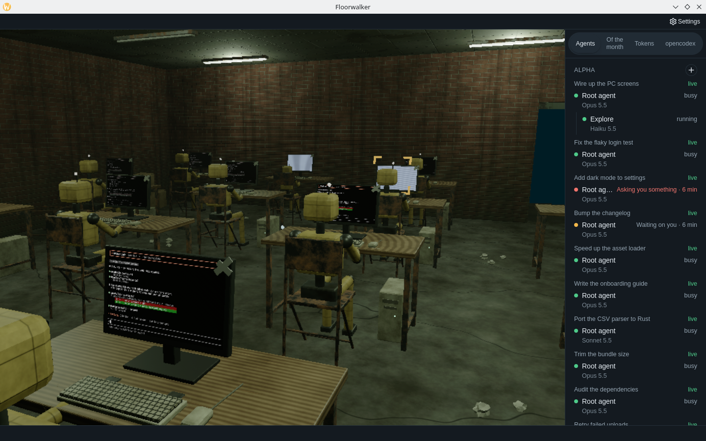
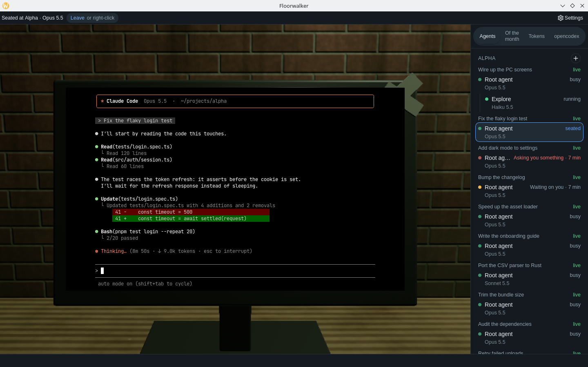
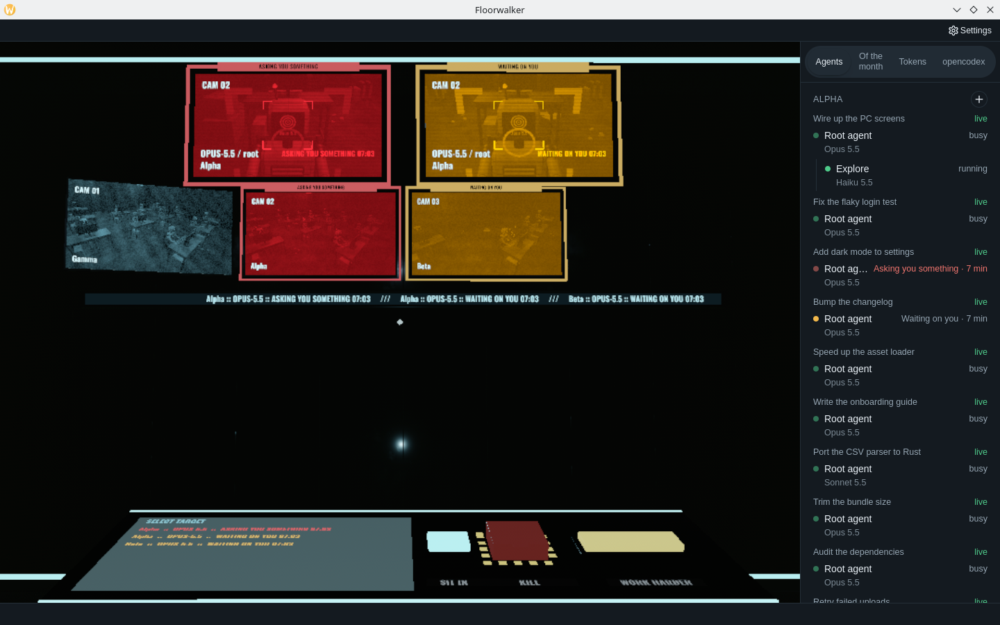

# Floorwalker

Floorwalker is a desktop app that turns your Claude Code sessions into a 3D world.
Each open project is a room off one corridor, each running agent a robot at a desk,
and a side panel lists every session with its agents, models and token use. You can
walk the rooms, sit in at a background session's PC to type into its terminal, start
a new session in a project, and watch the whole floor from the CCTV room.



| Sitting in at a session | The CCTV room |
| --- | --- |
|  |  |

<sub>Screenshots use made-up sessions.</sub>

The app runs entirely on your machine. There is no account, no sign-in and no
service: it reads Claude Code's and opencodex's own files, runs `claude` for you,
and keeps its settings on the device. See [the feature inventory](docs/features.md)
for what it does and does not do.

Floorwalker is an independent, unofficial project, not affiliated with or endorsed
by Anthropic (see [Trademarks](#trademarks)).

## Supported

Floorwalker is early software and supports one setup today:

- **Linux, on a native Wayland session.** The app refuses to start under X11 or
  XWayland, and there is no macOS or Windows version. It is developed and tested on
  KDE Plasma (KWin); other Wayland compositors may work but are untested.
- **The Claude Code CLI (`claude`) only.** Floorwalker shows the sessions of
  command-line Claude Code: the ones you run in a terminal or start with
  `claude --bg`. Claude Code in the Claude desktop app, on the web or in an IDE, and
  other coding agents, are not supported. It was built against Claude Code
  2.1.299–2.1.304 and reads Claude Code's own files, whose format can change between
  versions, so a newer Claude Code may need an update here. If you use opencodex,
  its usage shows in the opencodex tab.

## Before you run it

Floorwalker can act on your real Claude Code sessions, so know what each action does:

- **Sitting in** at a PC types into that session, exactly as at its terminal.
- **KILL**, in the CCTV room, ends the real session (SIGTERM, then SIGKILL after
  about 5 s).
- **WORK HARDER**, in the CCTV room, sends the prompt "WORK HARDER" to the real
  session.
- **New session** (the **+** by a project) runs `claude --bg` in that project's
  folder.

Everything else is read-only. The app reads `~/.claude` and opencodex's files and
never sends them anywhere; it makes no network connections of its own (the `claude`
processes it starts are Claude Code's own). Quitting leaves every session running.

## How it was built

Most of this repository was written by AI coding agents, directed and reviewed by
its owner:

- **Claude Opus 5.5**, through Claude Code, wrote most of the code, tests and docs.
  Its commits carry a `Co-Authored-By: Claude Opus 5.5` trailer.
- **DeepSeek V4.1 Flash** wrote much of the rest.
- **Matt Pocock's agent skills** (`mattpocock-skills`) set the way of working. Each
  effort starts as a map and a spec, is broken into numbered tickets, and is settled
  through grilling interviews with the owner, research notes and throwaway
  prototypes before it is built test-first. The domain language lives in
  [`GLOSSARY.md`](GLOSSARY.md), and every decision with a trade-off is recorded as an
  ADR in [`docs/adr/`](docs/adr/).

That process leaves its record in the repository:

| Where | What |
| --- | --- |
| `GLOSSARY.md` | The canonical terms (room, desk, robot, sit in, flag, kill, ...) and the synonyms to avoid |
| `docs/adr/` | Architecture decision records, each with its considered options and consequences |
| `docs/agents/` | How the skills use this repo: the local issue tracker, triage labels and domain docs |
| `AGENTS.md` | The entry point an agent reads first |

Each effort's map, spec, tickets, research notes and demonstrations live in a local
issue tracker, `.scratch/` (see [`docs/agents/issue-tracker.md`](docs/agents/issue-tracker.md)),
which is kept out of the public repository. The efforts so far, in order: `2d-app-gui`,
`3d-world`, `side-panel`, `sweatshop-rooms`, `management-rooms`, `agent-screens`,
`local-only` and `floorwalker`.

## Architecture

The app is one Tauri v2 process with three parts: a React page in a transparent
webview, a thin Rust shell, and a Bevy world drawn natively underneath the page. Two
Rust crates beside the shell hold everything it knows about agents and terminals, and
neither depends on Tauri or Bevy, so they test in seconds.

```
┌─────────────────────── one Tauri v2 process (Linux, native Wayland) ───────────────────────┐
│                                                                                            │
│  web/  React page in a transparent webview                                                 │
│  ┌───────────────┬──────────────────────────────┬───────────────┐                          │
│  │ top bar,      │ world view                   │ side panel:   │                          │
│  │ Settings,     │ (left unpainted, so Bevy     │ agent tree,   │                          │
│  │ licences      │  shows through; xterm.js     │ statistics    │                          │
│  │               │  overlay when seated)        │               │                          │
│  └───────────────┴──────────────────────────────┴───────────────┘                          │
│                        │ Tauri IPC: invoke, events, channels                               │
│                        ▼                                                                   │
│  desktop/src-tauri/src/  thin shell: Wayland check, ~20 commands, managed state            │
│    ├─ world::Controller ──▶ Bevy 0.20 on the `bevy-world` thread                           │
│    │                         └─▶ own wl_subsurface below the GTK toplevel                  │
│    ├─ agents::Registry      reads ~/.claude and opencodex files, `claude agents --json`    │
│    └─ terminals::Terminals  `claude attach` under app-owned PTYs → PC images + overlay     │
│                                                                                            │
└────────────────────────────────────────────────────────────────────────────────────────────┘
          │ read-only                 │ attach, `claude --bg`        │ kill: SIGTERM
          ▼                           ▼                              │ work harder: socket line
   ~/.claude, opencodex      Claude Code background sessions ◀───────┘
```

### The page (`web/`)

React 19 on Vite 8 with file routes (`vite-plugin-pages`), Tailwind 4 and HeroUI v3
themed by the repo's own tokens ([ADR-0001](docs/adr/0001-hero-ui-v3-component-kit.md),
[ADR-0006](docs/adr/0006-repo-tokens-use-heroui-variable-names.md)). The theme is
dark-first and settled before first paint
([ADR-0007](docs/adr/0007-repo-owned-theme-switch-defaulting-to-dark.md)).

| Path | Purpose |
| --- | --- |
| `src/pages/` | Routes: `world` (the screen the app opens on), `agents` (the side panel alone), `settings`, `license`, `oss-licenses` |
| `src/world/` | The page's side of the world contract: reporting the world view's rectangle, pointer capture, the seated terminal (xterm.js over the PC's glass), the quit prompt. Desktop build only |
| `src/agents/` | The side panel: agent tree, Of the month, Tokens and opencodex views. It takes a client as a prop and never imports Tauri: `tauri-client.ts` in the desktop build, fixtures in browser development |
| `src/theme/`, `src/styles/` | The theme preference and the token layer |
| `src/content/`, `scripts/` | The generated open-source licences page and the validator that runs before every build |
| `src/test/` | `fake-shell.ts`, the shell faked at its IPC boundary for the jsdom tests |

The page reaches nothing but the shell: the CSP's `connect-src` allows no network.
The desktop build is `vite --mode desktop`; the browser build is a development aid with
no world.

### The shell (`desktop/src-tauri/src/`)

The shell stays thin on purpose. `lib.rs` refuses to start without a native Wayland
display (`platform.rs`), creates three pieces of managed state (the world controller,
the agent registry and the session terminals), and exposes about twenty commands, all
declared in `build.rs`'s app manifest and granted only to the `main` window:

- `world_*`: start, stop, status, the world view's rectangle, look and click
  forwarding, capture, go to desk, sit in and leave, settings and strings.
- `agents_snapshot`, `session_new` and the three statistics commands.
- `terminal_stream` and `terminal_input` for the seated view.

The main window opens hidden and transparent, and is shown once its page has loaded,
so the desktop never shows through an unpainted page.

### The world (`desktop/src-tauri/src/world/`)

Bevy 0.20, pinned to that minor, runs on a worker thread with a custom runner and no
`bevy_winit`, so it owns neither a window nor an event loop. It presents into its own
Wayland subsurface placed below the GTK toplevel, and the page leaves the world view
unpainted so it shows through
([ADR-0009](docs/adr/0009-bevy-under-a-transparent-webview-on-wayland.md), superseding
the separate world window of [ADR-0008](docs/adr/0008-bevy-world-on-a-worker-thread.md)).
The page reports the world view's rectangle, which becomes the camera viewport; keys
are caught from GTK and pointer capture uses the webview's Pointer Lock.

- **Lifecycle**: `controller.rs` owns it behind a narrow `Launcher` seam and is tested
  with a stand-in world, no GPU. `engine.rs` is the real launcher. Once started the
  world keeps warm until quit, and is suspended, not stopped, while nobody can see it.
- **Pure rules, Bevy at the edges**: `floor_plan`, `cctv_state`, `cctv_geometry`,
  `seating`, `picking`, `marker`, `names` and `squad` decide what the world shows and
  are plain Rust with unit tests. The Bevy systems (`corridor`, `rooms`, `portals`,
  `feeds`, `focus`, `console`, `seat`, `punishments`, `wrecks`, ...) only draw what
  they decide.
- **Rooms bigger on the inside**: each project room's doorway sits a short step from
  its neighbours, but its interior lives elsewhere in world space and is joined to the
  corridor by a two-way render-to-texture portal. Only the nearest doorways are live
  ([ADR-0011](docs/adr/0011-rooms-bigger-on-the-inside-through-portals.md)).
- **CCTV room**: the monitor wall of camera feeds, focus monitors of flagged agents,
  the ticker and the console with its KILL and WORK HARDER buttons. A punishment asks
  for its real-session effect once, as a `SessionRequest` in the world's reports; the
  world never reaches into the OS itself.
- **Assets**: every model and texture is generated by headless Blender scripts in
  `desktop/world-assets/` at build time; only the scripts are committed
  ([ADR-0012](docs/adr/0012-world-assets-are-generated-by-blender-at-build-time.md)).
  Custom shaders are WESL (`portal`, `monitor`, `focus`, `ticker`).

### The agent registry (`desktop/src-tauri/agents/`)

The one source of agents and usage
([ADR-0010](docs/adr/0010-rust-agent-registry-from-read-only-files.md)). It reads,
never writes, Claude Code's transcripts and subagent metadata under `~/.claude` and
opencodex's `usage.jsonl` and quota caches, takes liveness from `claude agents --json`
(falling back to `~/.claude/sessions/<pid>.json`), and watches them for changes. It
serves a metadata-only `AgentTreeSnapshot`, with no field for message or tool content,
pushed at most about once a second to both the side panel and the world, so the two
never disagree. Usage is aggregated here rather than in the webview because a month of
ledger is hundreds of MB.

Everything external is injectable (`Sources`, `Clock`, `Liveness`, `Processes`), and
the parsers are tested against scrubbed fixtures captured from several Claude Code and
opencodex versions (`tests/fixtures/`). Nothing is written to disk: the index is
rebuilt on each start.

It acts on a real session in exactly two ways, each only after verifying the session's
`claude` process by its session file and its start time in `/proc`, so a reused pid is
never touched:

- **Kill** sends SIGTERM, then SIGKILL after about 5 s
  ([ADR-0013](docs/adr/0013-kill-ends-the-real-session.md)).
- **Work harder** writes one `WORK HARDER` user prompt to Claude Code's messaging socket
  ([ADR-0014](docs/adr/0014-work-harder-sends-a-prompt.md)).

`session_new` runs `claude --bg` in the project's folder for **New session**.

### Session terminals (`desktop/src-tauri/terminals/`)

A background session's terminal comes from running `claude attach <id>` under a PTY
the app owns, at a fixed 100 × 30
([ADR-0015](docs/adr/0015-session-terminals-through-claude-attach.md)). Each attach
feeds an `alacritty_terminal` grid that is painted into the PC's image in the world.
While the user sits in, the raw output also streams to the page's xterm.js overlay over
a Tauri channel, and the user's keys go back to that attach alone. A live budget (the
seated session plus the three nearest PCs) bounds how many attaches run, since each is
a full Claude Code process. The crate detects an attach turning into agent view and
re-attaches, so agent view is never shown. Quitting hangs up every attach and leaves
the sessions running.

### Shared packages

| Package | Purpose |
| --- | --- |
| `packages/i18n/` | Shared English strings with i18next / react-i18next; the world's fixed text is translated by the page and sent to Rust whole |

### Layout

| Directory | Purpose |
| --- | --- |
| `web/` | The app's pages |
| `desktop/` | Tauri v2 shell, the Bevy world, the `agents` and `terminals` crates and the world asset scripts; see [desktop setup](desktop/README.md) |
| `packages/i18n/` | Shared strings |
| `docs/` | Feature inventory, UI conventions, ADRs, agent guides |

## Develop

Requires Node.js 22.12+ (or 24), pnpm 10 (`corepack enable`), Rust, the Tauri
prerequisites and Blender 4.3; [desktop setup](desktop/README.md) has the details.
From the root:

```bash
pnpm install
pnpm --filter desktop tauri dev
```

`pnpm dev:web` runs the pages alone in a browser, on fixtures where the desktop app
reads real files. The browser build has no world, so it opens on Settings.

Always build the executable through `tauri build` (for example
`pnpm --filter desktop tauri build --no-bundle`): a bare `cargo build` embeds whatever
`web/dist` already holds.

## Validation

```bash
pnpm lint
pnpm test   # the web tests (vitest), the legal validator and the licences check
pnpm build:web
cd desktop/src-tauri && cargo test --workspace && cargo clippy --workspace
```

The web tests run the pages as the desktop build in jsdom against a shell faked at
its IPC boundary (`web/src/test/fake-shell.ts`). The desktop crate's tests need a
page build in `web/dist`, or a placeholder `web/dist/index.html`. `cargo test -p agents`
and `cargo test -p terminals` run the two crates alone, without building Bevy.

## Tooling

Use package scripts for linting (oxlint) and formatting (Prettier).

## Contributing and security

See [CONTRIBUTING.md](CONTRIBUTING.md) to contribute, and [SECURITY.md](SECURITY.md)
to report a vulnerability privately.

## Trademarks

Floorwalker is an independent project. It is not affiliated with, endorsed by or
sponsored by Anthropic. Claude and Claude Code are trademarks of Anthropic, PBC. Other
company and model names shown on robots' faces are trademarks of their owners and are
used only to say which model an agent runs.

## License

Copyright (C) 2026 leonardschub (GitHub username)

This program is free software: you can redistribute it and/or modify it under the
terms of the GNU Affero General Public License as published by the Free Software
Foundation, either version 3 of the License, or (at your option) any later version.

This program is distributed in the hope that it will be useful, but WITHOUT ANY
WARRANTY; without even the implied warranty of MERCHANTABILITY or FITNESS FOR A
PARTICULAR PURPOSE. See the GNU Affero General Public License in [LICENSE](LICENSE)
for more details.

Bundled third-party components keep their own licenses; see the app's open-source
licenses page (`web/src/content/legal/oss-licenses.md`).
